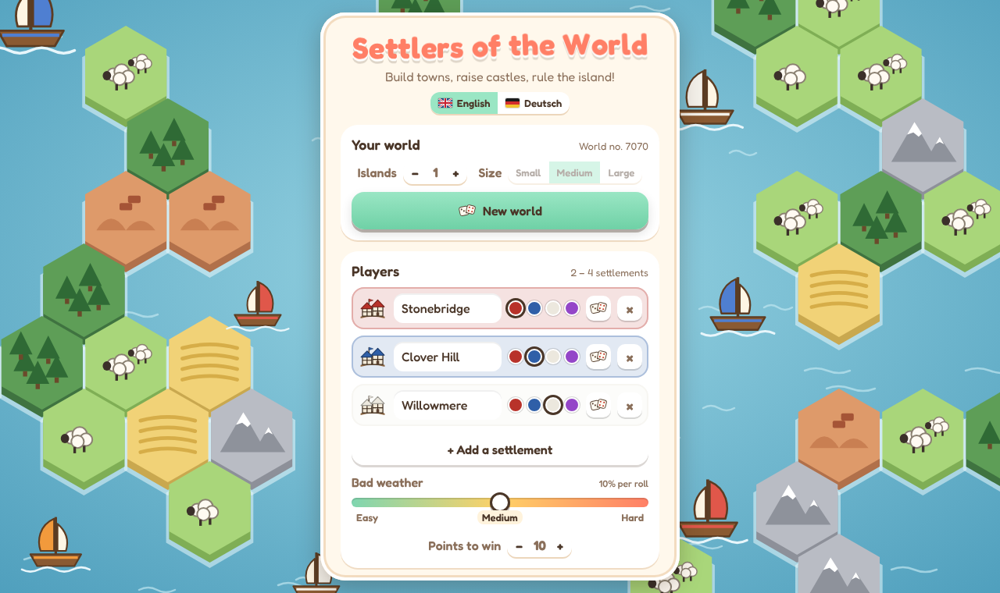
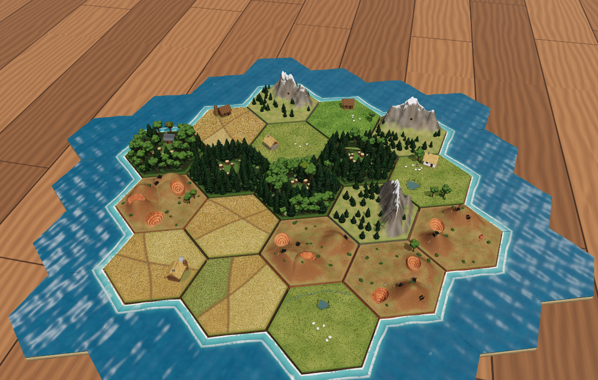

# Settlers of the World

A cozy, hand-crafted hex strategy game for 2–4 players on one screen, made with
[three.js](https://threejs.org). Build roads, towns and cities on a 3D island,
sail out into the fog to discover new islands, trade with your rivals, and
watch out for pirates and tornados.

Runs right in your browser: no install, no account, no build step.

<p align="center">
  <a href="https://afaisst.github.io/SettlersOfTheWorld/"></a>
</p>

<p align="center">
  <a href="https://afaisst.github.io/SettlersOfTheWorld/">afaisst.github.io/SettlersOfTheWorld</a>
  &nbsp;·&nbsp; <a href="https://afaisst.github.io/SettlersOfTheWorld/help.html">How to play</a>
  &nbsp;·&nbsp; <a href="#play-offline">Play offline</a>
</p>

<p align="center">
  
  
</p>

## Features

- **Hand-crafted 3D tiles**: forests with swaying trees, pastures with grazing
  sheep, wheat fields, clay hills and snowy mountains, with an animated sea and
  surf along the shores.
- **A world to explore**: choose how many islands and how big. Everything
  beyond your home island is hidden under fog of war until a ship reveals it.
- **Ships**: build ships, load them with goods, sail them to other islands and
  found new settlements there. Each island keeps its own resources.
- **Piracy and tornados**: rob enemy ships on the same hex, and dodge the
  storms that roam the sea and sink anything they hit.
- **Weather**: bad-weather events at easy, medium or hard frequency.
- **Trading** between players, including gifts.
- **Save and continue**, a minimap, a per-player camera, and victory fireworks.
- **English and German**, with a complete rules page in both languages.

## Play online

Open **<https://afaisst.github.io/SettlersOfTheWorld/>** in a recent desktop browser with WebGL (Chrome, Edge,
Firefox or Safari) and click **Play!**. Saved games are kept in your browser.

## Play offline

The game also runs completely offline: everything it uses (three.js, the
font) is bundled in this repository. Browsers refuse to run JavaScript modules
from a page opened straight from disk (`file://`), so it is started through a
small local web server. Python 3 ships one.

1. **Download** the game, either with git:

   ```bash
   git clone https://github.com/afaisst/SettlersOfTheWorld.git
   cd SettlersOfTheWorld
   ```

   or with **Code ▸ Download ZIP** on the GitHub page, then unzip it.

2. **Start it**:

   - **macOS**: double-click `start.command`. It starts the server and opens
     the game in your browser. Close the Terminal window to stop it.
     (On first launch macOS may block it: right-click ▸ *Open*, or run
     `chmod +x start.command` if it was downloaded as a ZIP.)
   - **Windows / Linux / any system with Python 3**: in the game folder, run

     ```bash
     python3 serve.py 8000
     ```

     (on Windows: `py serve.py 8000`) and open
     <http://localhost:8000> in your browser.

After the download, no internet connection is needed. `serve.py` is Python's
built-in server with caching turned off, so a reload always picks up changes.
Any other static file server works too, for example `python3 -m http.server`
or `npx serve`.

Saved games are stored per address, so a game saved online doesn't show up in
the offline copy (and the other way round).

## How to play

Click **How to play** in the start menu (or open [the rules page](https://afaisst.github.io/SettlersOfTheWorld/help.html)) for the full,
illustrated rules. The numbers on that page (costs, points, chances, supplies)
are read straight from the game code, so they are always current.

In short: roll the dice, collect resources from the tiles next to your
settlements, and spend them on roads, towns, cities and ships. The first
empire to reach the chosen number of victory points (3–20, default 10) wins.

### Controls

| Action              | Input                              |
| ------------------- | ---------------------------------- |
| Pan the map         | Drag                               |
| Rotate the map      | Shift + drag                       |
| Zoom                | Mouse wheel / trackpad pinch       |
| Build / select      | Click                              |
| Jump on the map     | Click or drag on the minimap       |
| Menu (save, graphics, exit) | **Menu** button in the game |

The **Graphics** setting (High / Balanced / Fast) in the start menu and game menu helps on slower
machines.

## Project structure

```
index.html          start menu and game
help.html           rules page (content generated by src/help.js)
start.command       macOS launcher
serve.py            no-cache local web server
css/                styles for the game and the rules page
vendor/             bundled three.js 0.170 and the Fredoka font (for offline play)
docs/               screenshots for this README
src/
  main.js           entry point
  i18n.js           translation helper t(); i18n.de.js holds the German texts
  help.js           builds the rules page from the game's rule constants
  core/             renderer, camera, noise and terrain helpers
  board/            hex layout and the vertex/edge board graph
  tiles/            the 3D terrain tiles, water and props
  pieces/           roads, towns, cities, ships and flags
  game/             rules (game.js), turn flow (controller.js), HUD, menu,
                    map generation, fog, weather, tornados, fireworks, minimap…
  workshop.js       developer view for browsing single tiles
```

No bundler or package manager is involved: the code is plain ES modules,
loaded through an import map in `index.html`.

## Contributing notes

- **Text**: every piece of UI text goes through `t('English text')` and gets a
  German line in `src/i18n.de.js`.
- **Rules page**: when a rule, control or screen changes, update the matching
  section in `src/help.js`, in both languages.
- **Performance**: don't add or remove three.js lights while the game runs (it
  makes every material recompile). Use glow sprites instead.

## Credits

- [three.js](https://threejs.org) (MIT license, see `vendor/three/LICENSE`)
- [Fredoka](https://fonts.google.com/specimen/Fredoka) font (SIL Open Font
  License, see `vendor/fonts/OFL.txt`)

Made by Andreas Faisst.
